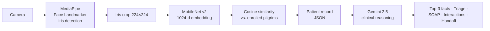

# BioLens

**Iris-based emergency identification for pilgrims who can't speak for themselves.**

### ▶ [Live Demo — biolen.netlify.app](https://biolen.netlify.app)

---

<div dir="rtl">

## نبذة

**بايولنز** نموذج أولي لتحديد هوية الحاج في الحالات الطارئة عبر مسح قزحية العين، حتى لو كان فاقدًا للوعي أو لا يحمل هويته أو لا يتكلم لغة المسعف.
بمجرد التعرّف عليه يظهر ملفه الطبي، ويستخرج الذكاء الاصطناعي أهم ٣ معلومات منقذة للحياة (الحساسية، الأدوية، الأمراض).
يدعم التطبيق فرز الإصابات الجماعية بروتوكول START، وكتابة ملاحظات SOAP، وفحص تعارض الأدوية، وتسليم الحالة للمستشفى.
الواجهة ثنائية اللغة (عربي / إنجليزي)، وجميع بيانات الحجاج في العرض تجريبية ومُصطنعة.

</div>

---

## The problem

During Hajj, emergency responders regularly reach pilgrims who are unconscious, confused, or in distress. Often the patient carries no ID, and the medic and the patient share no common language. The medic starts with no name, no allergy list, no medication history and no known conditions, and these are the facts that decide what's safe to give in the next few minutes. A paper card can be lost, a phone can't be unlocked on an unresponsive patient, and family, when present, may not share the responder's language either.

## The solution

BioLens identifies the patient from their eye. A camera scan finds the iris and turns it into a numeric embedding. That embedding is matched against enrolled pilgrims, and the matching medical record opens in seconds. An LLM then reads the full record and surfaces only what matters right now: the top three life-saving facts, each with a recommended action. From the same screen the responder can triage, document, check drug safety and hand off to a hospital.

## Key features

| Feature | What it does |
|---|---|
| **Iris matching** | MediaPipe Face Landmarker locates both irises (landmarks 468–477) from the camera. The iris region is cropped to 224×224, embedded with MobileNet v2 (1024-d), and compared to the enrolled pilgrims by cosine similarity (match threshold 0.85). |
| **AI top-3 critical facts** | Gemini reads the full record and returns exactly three ranked facts (allergies, medications, conditions, vitals) with a recommended action for each. It uses a structured JSON schema. |
| **START triage** | A deterministic START-protocol rules engine assigns a baseline color from vitals. A Gemini context layer then confirms or adjusts it and returns three immediate actions. The mass-casualty view sorts all patients red → green. |
| **SOAP notes** | One click generates a Subjective / Objective / Assessment / Plan note from the record plus the interventions given. It can be edited, copied or printed. |
| **Drug interactions** | Compares home medications with proposed emergency drugs. Labels are pulled from openFDA where available, and each alert is tagged as `openFDA`-sourced or AI-knowledge. |
| **Hospital handoff** | Ranks nearby hospitals by distance, required specialties, available beds and ED status, then produces a concise handoff summary for the receiving team. |
| **AR / EN bilingual** | Full Arabic and English UI with RTL layout, plus voice read-out of the top facts using the browser's text-to-speech (`ar-SA` / `en-US`). |

Also included: a Mecca cases map with a severity heatmap, an operations dashboard, and a presenter "Director" panel (`⌘/Ctrl + Shift + D`).

## How it works



Steps A–F run entirely in the browser: computer vision with MediaPipe (WASM/GPU), embeddings with TensorFlow.js, and matching in plain TypeScript. Only step G talks to an LLM. It uses Gemini 2.5 Flash for the fast calls (top-3 facts, translation, handoff) and Gemini 2.5 Pro for the heavier reasoning (triage, SOAP, interactions). Every response is constrained by a JSON schema.

## Tech stack

| Layer | Technology |
|---|---|
| UI | React 19, TypeScript, Vite |
| Styling | Tailwind CSS, Radix UI (shadcn/ui), Framer Motion |
| State | Zustand |
| Routing | React Router |
| i18n | i18next / react-i18next (Arabic + English, RTL) |
| Iris detection | MediaPipe Tasks Vision (Face Landmarker) |
| Embeddings | TensorFlow.js + MobileNet v2 |
| Matching | Cosine similarity (TypeScript) |
| Clinical reasoning | Google Gemini 2.5 Flash / Pro (`@google/generative-ai`) |
| Drug data | openFDA drug label API |
| Maps | Leaflet, react-leaflet, leaflet.heat, CARTO tiles |
| Voice | Web Speech API (`speechSynthesis`) |
| Optional proxy | Cloudflare Worker (`/worker`) to keep the API key server-side |
| Hosting | Netlify (static) |

## Demo mode

The public demo at **[biolen.netlify.app](https://biolen.netlify.app)** is a static, demo-only build:

- **It makes zero AI API calls and ships no API key.** It is built with `VITE_DEMO_ONLY=true` and an empty key, so every Gemini and openFDA call path throws before any network request is made.
- All AI output is served from a pre-generated cache, [`public/data/ai-precache.json`](public/data/ai-precache.json), loaded at startup.
- **Iris scan:** the scan screen has two modes. **Demo** lets you pick which pilgrim to "scan," and the match result is set to that pilgrim. **Live** runs the real camera → MediaPipe → MobileNet → cosine pipeline, but against synthetic reference irises (see below), so it will not recognize a real person.

What's cached:

| Flow | Demo build |
|---|---|
| Top-3 life-saving facts | ✅ all 5 pilgrims |
| START + AI triage | ✅ all 5 pilgrims |
| SOAP notes | ✅ all 5 pilgrims |
| Suggested interventions | ✅ all 5 pilgrims |
| Drug-interaction analysis | ✅ pilgrims 1–3 (prefilled intervention set) · demo notice for 4–5 |
| Hospital handoff summary | ✅ pilgrim 3 · demo notice for others (hospital ranking itself works for all) |
| Translate top facts | Demo notice ("Demo mode — available in full version") |
| Voice read-out, map, dashboard | ✅ work fully (no AI calls) |

Inputs that would trigger new AI calls, such as editing the intervention text, are read-only in the demo build.

## Run locally

Requires Node.js and npm.

**Full mode (live Gemini calls):**

```bash
npm install
cp .env.example .env      # then set VITE_GEMINI_API_KEY in .env
npm run dev
```

> In full mode the key is inlined into the client bundle. Use it only on your own machine. To keep the key server-side, deploy the Cloudflare Worker in [`/worker`](worker/) and set `VITE_USE_WORKER_PROXY=true` and `VITE_WORKER_URL` instead.

**Demo-only build (what's deployed, no key needed):**

```bash
npm install
npm run build:demo
npx vite preview
```

## Prototype vs. production

BioLens is a **proof of concept**, and it's worth being explicit about what that means:

- **The iris pipeline is not biometric-grade.** It uses a general-purpose ImageNet model (MobileNet) on visible-light webcam frames. This shows the identify → record → AI flow, but it is **not certified NIR iris biometrics** and makes no accuracy claims. The repo ships no real iris images; the five enrolled references are procedurally generated synthetic irises.
- **A production system would need:**
  - **NIR iris scanners**, plus a proper iris-recognition algorithm and template format with measured false-match and false-non-match rates.
  - **A secure, central biometric database** with enrollment at visa issuance or arrival, instead of five local JSON records.
  - **Offline mode**, because crowded sites have unreliable connectivity.
  - **PDPL compliance** (Saudi Personal Data Protection Law), covering consent, purpose limitation, retention, access control and audit logging for biometric and health data.
  - Server-side AI calls, authentication and roles for medics, and clinical validation of all AI output before any real-world use.

## Disclaimer

- **All five pilgrims are synthetic.** Every name, record, vital sign, contact and medical history in this repository is fictional and was written for demonstration only.
- **BioLens is not a medical device.** It is not cleared or approved for clinical use, and its AI output must never be used to make real medical decisions.
